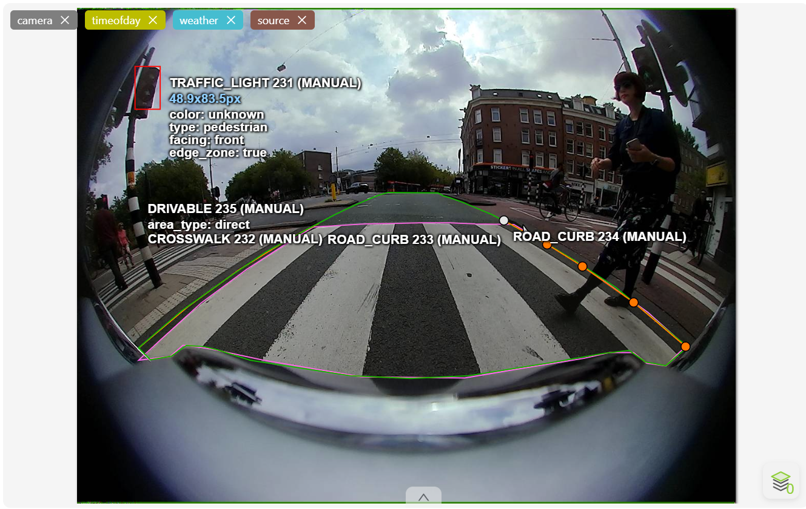

# Báo cáo cá nhân — Ngày 11
Họ tên: Đàm Trần Minh Quang               Mã học viên: 2A202603336  
Phiên bản CVAT (Help → About): v2.81
Guideline: Road v1.0    Lần nộp (`revision` trong manifest): 3  
Thời điểm export (ngày giờ trên CVAT): 23h30    Số lần nộp lại sau Rework: 2

## 1. Kiểm project
| Mục | Đúng như guideline Road v1.0? | Ghi chú |
| --- | --- | --- |
| 6 label, đúng kiểu | Đúng |  |
| Thuộc tính và giá trị | Đúng |  |
| 4 tag ảnh | Đúng |  |

Cách kết thúc polyline trên bản CVAT này: Hở

Cách đặt tag ảnh trên bản CVAT này: Create a tag

## 2. Số lượng đã gán
| Task | Ảnh | lane | road_curb | crosswalk | drivable | traffic_light | traffic_sign |
| --- | ---: | ---: | ---: | ---: | ---: | ---: | ---: |
| front | 12 | 30 | 16 | 3 | 26 | 30 | 39 |
| front-extra (đã làm 0 / 4) |  |  |  |  |  |  |  |
| fisheye | 8 | 11 | 16 | 7 | 6 | 6 | 10 |
| fisheye-extra (đã làm 0 / 4) |  |  |  |  |  |  |  |

## 3. Bảng ca khó
| Ảnh | Nhãn | Phân vân giữa | Đã chọn | Lý do |
| --- | --- | --- | --- | --- |
| A06 | Drivable | Direct và Alternative | Alternative | Đường thẳng thì direct, còn lại đường đi được thì Alternative |
| A08 | Lane | L1 và không gán | Không gán | Không nhìn rõ đường |
| B06 | Drivable | Direct và Không gán | Direct | Cam fisheye_left đang cho thấy xe đi sát lề bên trái nhưng còn khoảng trống phía trước vẫn vẽ |
| B07 | Drivable | Direct và Không gán | Direct | Cam fisheye_right đang cho thấy xe đi sát làn bên phải nhưng còn khoảng trống phía trước vẫn vẽ |
## 4. Phiếu QC 1 nhận được
Bạn kiểm lô của tôi:  Quyết định nhận được:  
| Mã lỗi | Số lỗi | Đồng ý? | Đã sửa? |
| --- | ---: | --- | --- |
| nặng | 6 | 0 | 0 |
| chính | 9 | 3 | 3 |
| nhẹ | 1 | 1 | 0 |

## 5. Kiểm file export
| File | Mở lại được? | Số shape ảnh 1 (job / file) | Số shape ảnh 2 (job / file) | Tag camera có trong XML? |
| --- | --- | --- | --- | --- |
| DamTranMinhQuang-manifest.json | Được | 12/20 | 8/20 | 20 |
## 6. Ảnh chụp màn hình
1. Tab Labels của project.
   
2. Một ảnh camera trước đã gán đủ (làn, vùng lái, đèn/biển).
   
3. Một ảnh fisheye đã gán, phóng to đoạn polyline cong.
   
4. Một đoạn XML có <polyline label="lane">.
   

## 7. Tự đánh giá
Lỗi bạn mắc nhiều nhất hôm nay (theo mã QC1-xx), và cách tránh ở Ngày 20: Em hay bị nhầm chức năng biển báo và vài ảnh label làn đôi sai. Lần sau em sẽ đọc kĩ guideline. 
Nhãn của bạn đi vào model ở đâu? Chọn một lỗi đã sửa và nói nó làm model học sai thế nào: Nhãn CVAT được xuất trong XML và dùng làm ground truth khi huấn luyện, đánh giá model. Em đã sửa một số ảnh gán sai thuộc tính `kind=double` cho làn đôi; nếu giữ lỗi, model có thể học nhầm vạch đơn thành vạch đôi (hoặc ngược lại), khiến dự đoán loại vạch và vị trí làn không chính xác, ảnh hưởng việc xác định làn đường.

## 8. (Tùy chọn, buffer) Từ polyline đến đích row-anchor
| y | 720 | 680 | 640 | 600 | 560 |
| --- | ---: | ---: | ---: | ---: | ---: |
| x của chúng tôi |  |  |  |  |  |
| x của bạn kia |  |  |  |  |  |

Trả lời 3 câu:

1. Năm số x đó chính là đích mà một model row-anchor học cho vạch này. Nếu bạn dừng polyline sớm 40 px, hàng nào đổi thành "không có làn"?
2. So với bạn được kiểm (cùng ảnh): ở hàng 720 và hàng 560, hai bạn lệch nhau bao nhiêu pixel? Lệch ở hàng nào ảnh hưởng LKA nhiều hơn (slide 25)?
3. Nếu polyline vẽ từ xa về gần (ngược quy tắc 2), cách tính trên có đổi không? Script nào sẽ gặp khó?
